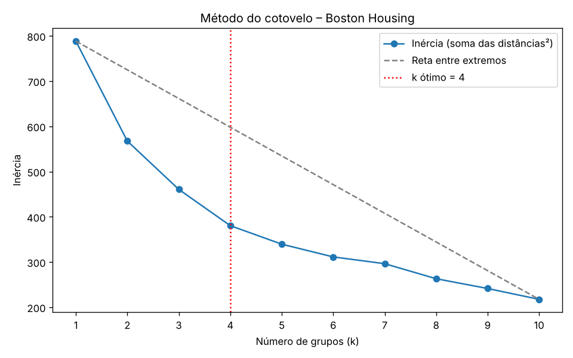

# Clusterização K-Means – Boston Housing

Avaliação do 2º bimestre: treinamento de um clusterizador **K-Means** sobre a base **Boston Housing**, com módulo de treinamento e módulo de inferência.

## Estrutura

```
kmeans-boston-housing/
├── data/
│   └── BostonHousing.csv        # base (506 residências, 14 atributos)
├── src/
│   ├── config.py                # caminhos e definição dos atributos
│   ├── preprocessing.py         # normalização / desnormalização
│   ├── train.py                 # MÓDULO DE TREINAMENTO
│   └── inference.py             # MÓDULO DE INFERÊNCIA
├── models/
│   ├── kmeans.joblib            # modelo treinado
│   └── preprocessor.joblib      # normalizador ajustado no treino
├── reports/
│   ├── cotovelo.png             # gráfico do método do cotovelo
│   ├── cotovelo.csv             # inércia e distância à reta por k
│   └── centroides.csv           # centroides desnormalizados
├── exemplo_residencia.json      # residência de exemplo para inferência
└── requirements.txt
```

## Instalação

```bash
python -m venv .venv
source .venv/bin/activate        # Windows: .venv\Scripts\activate
pip install -r requirements.txt
```

## Módulo de treinamento

```bash
python src/train.py
```

### 1. Normalização (dados categóricos × quantitativos)

| Tipo | Atributos | Tratamento |
|---|---|---|
| Quantitativos | `crim, zn, indus, nox, rm, age, dis, tax, ptratio, b, lstat, medv` | **MinMaxScaler** → intervalo [0, 1] |
| Categóricos | `chas` (binário: divisa com o rio), `rad` (código de acesso a rodovias: 1–8 e 24) | **One-Hot Encoding** |

`rad` parece numérico, mas é um **código**: o valor 24 não é "3× maior" que 8. Se fosse escalado como número, distorceria as distâncias do K-Means. Por isso ele e `chas` viram colunas 0/1 (uma por categoria). Valores ausentes, se houver, são preenchidos pela mediana (quantitativos) ou pela moda (categóricos), calculadas no treino.

O normalizador é ajustado **apenas no treino** e salvo em `models/preprocessor.joblib`, para que a inferência use exatamente a mesma transformação.

### 2. Balanceamento
Não aplicado (não é necessário: a tarefa é não supervisionada).

### 3. Número ótimo de grupos: método do cotovelo (distâncias)
Para k = 1…10 calcula-se a **inércia** (soma das distâncias quadráticas de cada ponto ao seu centroide). Em seguida traça-se uma reta entre o primeiro e o último ponto da curva. O **k ótimo é o ponto da curva com a maior distância perpendicular a essa reta**:

$$d_k = \frac{|(y_2-y_1)\,k - (x_2-x_1)\,I_k + x_2 y_1 - y_2 x_1|}{\sqrt{(y_2-y_1)^2 + (x_2-x_1)^2}}$$

Resultado: **k = 4**.



### 4. Treino e salvamento
O K-Means final é treinado com k = 4 (`n_init=10`, `random_state=42`) e salvo em `models/kmeans.joblib`.

### Centroides obtidos (desnormalizados)

| Grupo | Nº resid. | crim | zn | indus | nox | rm | age | dis | tax | ptratio | lstat | medv | chas | rad |
|---|---|---|---|---|---|---|---|---|---|---|---|---|---|---|
| 0 | 115 | 0.69 | 11.1 | 9.76 | 0.571 | 6.39 | 69.2 | 3.70 | 332 | 16.5 | 10.7 | 25.7 | 0 | 5 |
| 1 | 132 | 12.76 | 0.0 | 18.10 | 0.672 | 6.02 | 89.8 | 2.06 | 666 | 20.2 | 18.6 | 16.4 | 0 | 24 |
| 2 | 110 | 0.39 | 14.7 | 10.75 | 0.504 | 6.13 | 60.8 | 4.43 | 336 | 19.1 | 12.2 | 21.4 | 0 | 4 |
| 3 | 149 | 0.15 | 19.1 | 6.32 | 0.475 | 6.55 | 55.0 | 4.94 | 292 | 17.9 | 9.3 | 26.4 | 0 | 3 |

O grupo 1 reúne as áreas urbanas centrais (criminalidade e impostos altos, maior % de baixa renda, menor valor). O grupo 3 reúne as áreas residenciais mais valorizadas e menos poluídas.

## Módulo de inferência

O módulo:
1. recebe os dados de uma nova residência;
2. normaliza com o mesmo pré-processador do treino;
3. infere o grupo com o modelo salvo;
4. exibe os dados **desnormalizados** do centroide inferido.

```bash
# modo interativo (pergunta atributo por atributo)
python src/inference.py

# residência de exemplo
python src/inference.py --exemplo

# a partir de um arquivo JSON
python src/inference.py --json exemplo_residencia.json

# via argumentos
python src/inference.py --crim 0.03 --zn 0 --indus 7.07 --chas 0 --nox 0.469 \
  --rm 6.8 --age 60 --dis 4.9 --rad 2 --tax 242 --ptratio 17.8 --b 392.8 \
  --lstat 6.5 --medv 27
```

Na desnormalização do centroide, os atributos quantitativos voltam à escala original (inverso do MinMax). Para os categóricos, mostra-se a categoria predominante no grupo e a proporção de residências nela. Exemplo: `chas = 0 (95% do grupo)`.

## Dicionário de atributos

| Atributo | Descrição |
|---|---|
| crim | taxa de criminalidade per capita |
| zn | % de terrenos residenciais com lotes > 25.000 pés² |
| indus | % de área comercial não-varejista |
| chas | 1 se faz divisa com o rio Charles, 0 caso contrário |
| nox | concentração de óxidos nítricos |
| rm | nº médio de cômodos por residência |
| age | % de imóveis construídos antes de 1940 |
| dis | distância ponderada a 5 centros de emprego |
| rad | índice de acessibilidade a rodovias radiais |
| tax | imposto predial por US$ 10.000 |
| ptratio | razão aluno/professor |
| b | 1000(Bk − 0.63)², Bk = proporção de pessoas negras |
| lstat | % da população de baixa renda |
| medv | valor mediano das residências (US$ 1000) |
